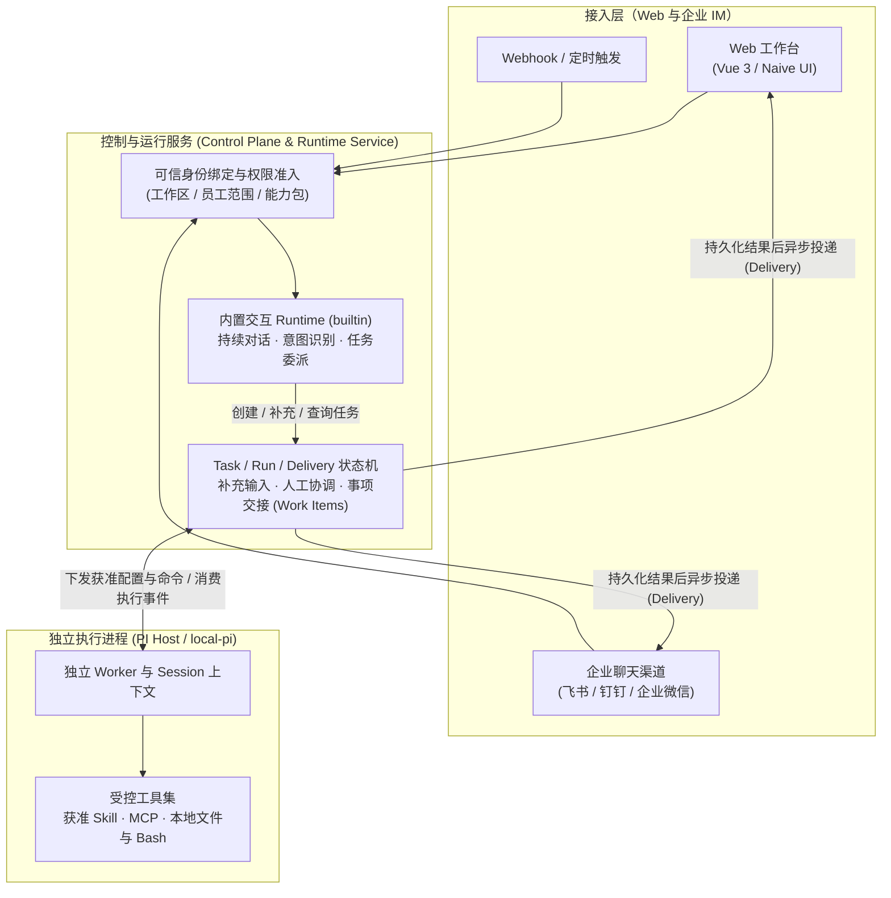

<!-- Modified for Identale; see the root NOTICE. -->

# Identale

**面向团队与组织的数字员工协同与任务执行平台。**

> **“让数字员工持续关注业务，在工作群里沟通，在企业自己的环境里办事，并在授权范围内跨群推动结果。”**<br>
> *主动推进和持续沟通是体验主线；跨群流转是协作高潮；自有环境和权限边界是信任底座。*

接入生态：**飞书 (Lark)** · **钉钉 (DingTalk)** · **企业微信 (WeCom)** · **Web 工作台** · **Webhook / 定时触发**

---

## 核心业务价值：它能为你解决什么？

传统的聊天机器人或单次执行的 Agent 工具在实际落地时，往往沦为“不戳不动的被动问答机、一跑工具就卡死群聊、换个群就串味越权、代码与核心数据在外部公网裸奔”。Identale 致力于解决**真实组织协同与业务提效**问题：

### 1. ⚡ 主动感知，7×24h 持续工作
不再被动等待人类在群里“@”才做出反应。系统支持 Webhook 接入、事件监听与定时调度（Cron）。数字员工能够持续关注代码仓库 PR、线上告警波动、巡检指标或未完结事项，在关键业务时刻主动在工作群发起提醒、汇报进展或触发执行链。

### 2. 💬 持续沟通，后台完成任务
彻底告别“Agent 调用重度工具执行数十秒，群聊完全被挂起卡死”。
- **前台秒级交流**：内置轻量交互 Runtime（`builtin`）实时响应沟通，边聊边理清需求；
- **后台异步执行**：独立工作进程（`PI Host / local-pi`）异步调用 Skill、MCP 或本地工具处理耗时任务；
- **任务中途可插话**：任务在后台运行期间，团队成员在群里随时可以追问进度，或通过带版本的输入修订（`inputRevision`）无缝追加新要求。

### 3. 🛡️ 企业自有环境，数据工具不出域
专为注重数据安全与私有资产的团队打造：
- **纯自托管部署**：本地代码库、任务工作目录、SQLite 数据库、内网私有 MCP 端点与 Bash 执行环境均位于企业受控的基础设施内；
- **严格降权隔离**：服务器服务采用专用的非 root 普通系统账号（`identity:identity`）运行，开启 `NoNewPrivileges=true` 并清空 capabilities；
- **核心数据不出域**：外部大模型仅用于逻辑推理与指令分发，本地私有凭据、业务数据库与执行资产绝不离开内网。

### 4. 🔄 跨群多员工协作，数据权限可控，任务闭环
- **跨群接力与事项流转（Work Items & Handoff）**：研发群员工排查完缺陷，可将事项结构化交接给运维群员工去发布；不同员工使用独立的会话上下文（`AgentSession`），避免多群上下文交叉串味与信息越权。
- **人在回路安全续跑（Human-in-the-Loop）**：遇到高风险操作或业务裁决时，执行段在安全检查点停稳并释放资源；相关决策人确认后，在同一 `Task` 下原位恢复继续推进。
- **事实先持久化，杜绝重复副作用**：任务执行结果先可靠落库，再异步投递消息。即便遇到网络超时或群消息发送失败，也绝不触发后台任务重复执行。

---

## 典型使用场景

- **个人与团队 AI 数字员工工作台**：在 Web 端集中管理多个不同职责的数字员工（如代码助手、文档整理员、运营分析员），共享工作区模型配置，按能力包精细分配 Skill 与 MCP 资源。
- **企业 IM 群聊与私聊协同**：接入飞书（WebSocket）、钉钉（Stream）或企业微信（智能机器人），团队成员在群话题或私聊中委派工作，员工在后台执行完成后自动将结果回告至原会话（各渠道能力边界详见 [渠道能力与扩展](docs/spec/26-channel-capabilities.md)）。
- **渠道能力与权限**。各渠道分别配置私聊、群定向消息和图片文件能力。飞书支持按授权补读群历史，以及保留近期群消息作为上下文。钉钉和企微的机器人接入暂不支持群历史补读。三家平台的原生待办和日程暂未接入。[渠道能力差异](docs/spec/26-channel-capabilities.md#授权群历史与实时群上下文)
- **读取已分享的会议资料和云文档**。优先使用应用身份，分别核验 API 权限与具体资料访问权。飞书、钉钉已有部分读取适配，企微业务资料读取仍待核验。[资料读取与配置](docs/spec/27-business-resource-reads.md)
- **人机协同长链路任务**：任务执行中遇到高风险操作或缺失业务信息时，自动发起人工确认请求；相关人员确认或补充信息后无缝继续同一任务。
- **事件驱动与定时作业**：通过 Webhook 或定时触发器，以明确的业务绑定身份自动触发数字员工执行巡检、汇总或处理流程。

---

## 快速上手与部署（Quick Start & Deployment）

支持 **macOS** 与 **Linux**。若本机已安装 Node.js，要求版本为 `>=24.19.0 <25`（npm `11.9.0`）；若未安装，启动脚本会自动下载固定版本 Node.js 到用户私有目录 `~/.identale/node`（首次运行需联网及 `bash`、`curl`、`tar/gzip`、`sha256` 工具）。

### 方式一：本地启动（配置自有模型，推荐完整体验）

```sh
git clone https://github.com/unrealm-ai/identale.git
cd identale
bash scripts/start.sh
```

启动时会显示 Node 下载、依赖检查 / 安装、后端编译、前端类型检查 / 打包，以及逐个服务的启动状态和耗时。下载在交互终端显示进度条；下载、安装、构建与就绪等待每 10 秒补充一次进行中提示，失败时标明阶段。请使用 `bash` 执行该入口。

1. **初始化账号**：浏览器打开 <http://127.0.0.1:15173>，注册首个管理员账号（系统会自动创建初始工作区并默认开启事项协作）。
2. **配置模型**：进入「工作区设置 → 模型配置」，填写你的模型服务 Base URL、Model ID 与 API Key（支持 OpenAI Chat Completions / Responses、Anthropic Messages 协议分支），点击连接测试并保存。
3. **创建数字员工并委派任务**：按向导创建员工、绑定模型与能力包（Skill / MCP），即可在对话页边聊边委派后台任务，在任务页实时查看执行过程、处理人工确认或接力事项。
4. **停止与重启**：在终端按 `Ctrl+C` 停止当前实例。本地数据库、私有凭据与会话记录默认保存在 `~/.identale`，再次运行 `bash scripts/start.sh` 会自动复用已有数据。

### 方式二：本地无 API Key 零成本试用（本地合成 Mock 模式）

如果你希望在不消耗真实大模型 Token 的情况下，快速走通「对话交互 → 任务派发 → 本地工具执行 → 结果回告」的完整闭环：

```sh
bash scripts/start.sh --mock
```

启动后参照 [本地合成任务试用指南](docs/local-mock-task-walkthrough.md) 与 [Mock 配置说明](mock/README.md) 配置本地合成模型与 MCP 端点即可体验（注：合成模型仅匹配固定试用指令；正常模式下未配置有效模型时系统会明确提示不可用，不会静默降级为 Mock）。

### 方式三：Linux 服务器一键部署（生产服务）

在启用 systemd 的 Debian / Ubuntu 服务器上，可以直接在自己的 home（例如 `/home/your-user`）下载代码并部署：

```sh
cd ~
git clone https://github.com/unrealm-ai/identale.git
cd identale
sudo bash scripts/start.sh --host your-domain-or-ip --port 15173
```

- **自动化配置**：自动安装必要系统工具与 Node、编译前端发布产物、注册 `systemd` 服务并通过 Nginx 提供 HTTPS 服务（缺省自动生成自签名证书，亦可通过 `--cert` 和 `--key` 挂载正式证书）。
- **原目录部署与定向 ACL**：代码留在下载目录，不复制到 `/opt`，也不更换代码属主。安装器按需安装 `acl` 工具，只向服务账号授权运行文件，并允许它穿过必要的 home 上级目录；不会递归授权整个 home、`.git`、`.env` 或私人凭据。更新代码后重新执行部署命令；运行期间不要移动或删除代码目录。文件系统必须支持 ACL，`--skip-install` 要求提前装好工具。
- **主机与目录要求**：`--host` 只填写 IP 或域名，不含 `https://`、端口或末尾 `/`；默认 HTTPS 端口为 `15173`。源码不要放在 `/root` 下；root 的 nvm Node 不会用于服务，脚本会改用 `/opt/identity` 下的受管 Node。
- **专用普通账号降权**：安装后应用进程统一运行在专用、禁止登录的 `identity:identity` 系统账号下，开启 `NoNewPrivileges=true` 并清空 capabilities，杜绝以 root 身份执行任务。
- **数据与旧配置**：新安装默认数据位于 `/var/lib/identity`，私有配置位于 `/etc/identity`。检测到旧部署时会保留旧路径和密钥，不会因换了下载目录或停止旧服务而自动变成全新安装；旧数据位于不可用路径时需明确迁移或由管理员备份、清理旧配置。不会自动删库重建。
- **进阶部署参数**：支持 `--port <端口>`、`--data-dir <数据目录>`、`--skip-install` 等参数，完整运维说明请参阅 [服务器部署说明 (docs/deployment.md)](docs/deployment.md)。

部署成功后访问 `https://你的IP或域名:15173/`，注册首个管理员并配置有效模型。自签名证书需要浏览器显式信任；页面就绪不代表真实模型连接已验证。此入口必须使用 **Bash**（`sudo bash ...`），不要用 `sh scripts/start.sh`。

### Agent 使用指引

接管本仓库的 AI Agent / 自动化助手请遵循以下规范与命令：

#### 1. 开发规范与架构约束
- **方案先确认**：在实施代码改动或新增测试前，必须仔细阅读 [AGENTS.md](AGENTS.md)，提出技术与测试方案并获得确认后再实施。
- **真实模型依赖**：正常运行必须配置有效大模型（OpenAI 或 Anthropic 兼容端点）；系统不会在缺少模型时自动伪造输出或静默降级为 Mock。
- **事实先持久化**：对话（`Conversation`）、会话（`AgentSession`）、任务（`Task`）、执行段（`Run`）与投递（`Delivery`）状态严格解耦。消息发送失败不得触发任务重复执行。

#### 2. 一键命令速查表

| 操作场景 | 执行命令 | 行为说明与 Agent 注意事项 |
| :--- | :--- | :--- |
| **本地启动** | `bash scripts/start.sh` | 首次运行自动准备 Node 与依赖，前台运行在 `http://127.0.0.1:15173`。<br>⚠️ **注意**：该命令为**前台常驻进程**。在非交互式 Agent 工具中请使用**后台任务机制**启动；优雅停止时向进程组发送 SIGINT (`Ctrl+C`)。 |
| **本地免 Key 试用** | `bash scripts/start.sh --mock` | 启动本地合成模型（Mock Model）与测试 MCP，用于无 API Key 场景下的交互与执行闭环验证。 |
| **服务器一键部署** | `sudo bash scripts/start.sh --host <IP_OR_DOMAIN>` | 在 Debian / Ubuntu 环境下一键完成 `systemd` 服务与 Nginx HTTPS 部署，自动降权至 `identity` 账号。 |
| **快速重新启动** | `bash scripts/start.sh --no-install --no-build` | 复用现有依赖和 `dist/` 构建产物快速拉起服务，跳过依赖安装与前端编译。 |
| **快速单元测试** | `npm run test:fast` | 执行轻量定向单元测试集（其他测试子集与验证命令见 [DEVELOPMENT.md](DEVELOPMENT.md)）。 |

#### 3. 运行互斥与环境隔离
- **代码目录互斥锁**：同一代码目录下，普通用户本地启动与 `sudo` 服务器部署由 `.identale-mode/` 文件锁互斥保护。禁止在同一检出目录下并发运行本地与服务器两种模式。
- **数据与凭据保护**：本地模式持久化数据保存在 `~/.identale`，服务器模式保存在 `/var/lib/identity` 与 `/etc/identity`。切勿将本地数据库、私有密钥、会话记录或执行产物提交到代码仓库。

---

## 核心架构与工作流（它是怎么做的？）

### 系统架构图



### 核心概念设计

- **数字员工（Digital Employee）**：承载长期身份、人设职责、渠道绑定与工具使用边界，无需为每一次临时任务重复拼装配置。
- **交互与执行分离（Interaction vs. Execution）**：交互角色负责实时沟通、任务管理与获准的只读查询；执行角色在独立 `PI Host` 进程中调用 Skill、MCP 和本地工具完成重度工作。
- **Task / Run / Delivery 独立生命周期**：
  - `Task` 代表一项业务目标及其授权快照与输入修订版本（`inputRevision`）；
  - `Run` 代表单次执行段（如首次运行、人工确认后的继续运行）；
  - `Delivery` 代表向指定目标的结果投递回执，与任务成功与否解耦。
- **事项协作（Work Items，Beta）**：支持多员工之间按职责进行结构化事项交接（Handoff）、进度同步与完结归档，每次交接使用独立的 `Task / Session`，避免跨员工私有上下文泄漏。

### 底层架构支撑与解耦机制

为了支撑高可靠的业务体验，Identale 从架构底层拒绝了简单的“套壳 Prompt”方案，采用工业级解耦设计：

| 常见 Agent 落地痛点 | Identale 的解决方案 | 核心实现机制 |
| :--- | :--- | :--- |
| **1. 对话与重度执行耦合，一跑工具就卡死聊天**<br>在同一个请求循环里跑长耗时任务，执行期间用户无法继续交流、插话或补充要求。 | **交互与执行双轨分离（Dual-Runtime）**<br>前台对话秒级响应，后台重度任务异步执行；任务运行中依然可以随时对话或追加新要求。 | 内置轻量交互 Runtime（`builtin`）负责持续沟通；独立进程 `PI Host`（`local-pi`）负责后台执行，支持带版本的补充输入（`inputRevision`）。 |
| **2. 状态混为一谈，通知失败导致任务重跑**<br>把一次聊天、一次模型调用和一次渠道消息推送混成一个状态，网络超时重试就会重复产生业务副作用。 | **五层领域模型解耦 + 事实先持久化**<br>严格区分对话、业务任务、单次执行段与结果投递；业务完成与消息送达独立核算。 | 拆分 `Conversation`、`Task`、`Run`、`AgentSession` 与 `Delivery`。先落库再投递，**通知失败绝不触发任务重新执行**。 |
| **3. 人工介入（Human-in-the-Loop）难闭环**<br>遇到需要人拍板的环节，要么进程一直挂起占资源，要么中断后丢失前序执行上下文。 | **安全停稳检查点 + 同 Task 跨 Run 续跑**<br>需要人工决策时安全停稳并释放执行段；确认后原位恢复上下文继续推进。 | 旧 `Run` 在安全检查点以 `needs_human` 结束，`Task` 转入等待人工；校验确认人身份与问题版本后，在同一 `Task / Session` 下创建新 `Run` 续跑。 |
| **4. 靠 Prompt 约束权限，多群多渠道易越权串味**<br>仅靠提示词告诉模型“不要读别人的数据”，在多群聊或多工具场景下极易被绕过。 | **宿主级可信身份绑定 + 按需上下文隔离**<br>身份、渠道租户与可用工具由平台宿主强制注入，模型无法自填调用身份或越权调工具。 | 员工使用范围与能力包（Skill / MCP）双重收窄权限；会话按渠道、群、话题隔离，通过受控 `fork / new` 与显式授权按需读取历史。 |

---

## 项目结构

| 路径 | 职责说明 |
| :--- | :--- |
| [`apps/web`](apps/web) | Vue 3 + Naive UI 前端工作台（对话、任务看板、事项协作、员工与资源管理） |
| [`apps/control-plane`](apps/control-plane) | 控制平台与运行服务入口、SQLite 存储适配、渠道 Adapter、通知与人工协调 |
| [`apps/runtime-host-pi`](apps/runtime-host-pi) | 独立 `PI Host` 进程、执行 Worker、Skill / MCP 装配与本地工具运行环境 |
| [`apps/mock-model`](apps/mock-model) | 显式启用的本地合成模型与合成 MCP 测试服务（`--mock` 模式） |
| [`packages/domain`](packages/domain) | 核心领域模型、状态转移与权限准入规则 |
| [`packages/application`](packages/application) | 应用层用例编排、Task / 交互 / 渠道服务与 Port 接口定义 |
| [`packages/contracts`](packages/contracts) | 跨模块 DTO、Runtime 准备 / Session / 执行契约与事项契约 |
| [`packages/runtime-builtin`](packages/runtime-builtin) | 内置交互 Runtime（LLM + tools 循环、会话 JSONL 记录与摘要维护） |
| [`scripts`](scripts) | 本地与服务器统一启动入口（`start.sh`）、环境初始化、部署模板与离线维护脚本 |

---

## 文档导航

### 快速上手与部署运维
- [开发与配置指南 (DEVELOPMENT.md)](DEVELOPMENT.md)：环境变量、端口配置、目录结构、构建与定向测试命令
- [本地合成任务试用 (docs/local-mock-task-walkthrough.md)](docs/local-mock-task-walkthrough.md)：无需 API Key 的端到端任务体验步骤
- [服务器部署说明 (docs/deployment.md)](docs/deployment.md)：Debian / Ubuntu `systemd` + Nginx HTTPS 部署与服务账号说明
- [安全说明 (SECURITY.md)](SECURITY.md)：执行权限边界、敏感数据保护与漏洞私下报告方式

### 架构设计与模块规格
- [公开规格索引 (docs/spec/README.md)](docs/spec/README.md)
  - [01：架构与模块边界](docs/spec/01-architecture-and-boundaries.md)
  - [02：任务、事件、人工继续与结果投递](docs/spec/02-tasks-events-and-delivery.md)
  - [03：数字员工、角色与配置](docs/spec/03-agents-and-profiles.md)
  - [04：上下文隔离与按需读取](docs/spec/04-context-and-knowledge.md)
  - [05：Runtime 与执行契约](docs/spec/05-runtime-and-provisioning.md)
  - [06：渠道、权限与安全](docs/spec/06-channels-storage-and-security.md)
  - [17：存储、保留与恢复](docs/spec/17-conversation-storage-and-retention.md)
  - [26：渠道能力与 Adapter 扩展](docs/spec/26-channel-capabilities.md)
  - [27 读取会议资料与云文档](docs/spec/27-business-resource-reads.md)

### 参与贡献与状态参考
- [参与贡献指南 (CONTRIBUTING.md)](CONTRIBUTING.md)：Issue 反馈、方案对齐约定与 PR 规范
- [当前实现入口与边界 (docs/STATUS.md)](docs/STATUS.md)：各核心领域源码入口与演进方向导航

---

## 安全与使用边界

> [!IMPORTANT]
> **当前版本为开发预览（Development Preview）。** 请在受控环境中评估与使用，并注意以下执行与隔离边界：

1. **本地工具执行无 OS 沙箱**：`local-pi` 中的文件读写与 Bash 工具以 `PI Host` 进程的操作系统身份运行。独立任务工作目录与业务工具白名单不能替代操作系统级的文件系统或网络沙箱，请勿将其直接用于承载不可信租户或执行不可信代码。
2. **服务器专用普通账号降权**：在 Linux 服务器上执行 `sudo bash scripts/start.sh --host IP_OR_DOMAIN` 时，安装器使用 `root` 完成系统与 Nginx 配置，而平台、运行服务与 `PI Host` 统一运行在专用、禁止登录的 `identity` 普通账号下（启用 `NoNewPrivileges=true` 并清空 capabilities）。但各服务与任务之间仍共享该系统账号，不构成多租户系统隔离。详见 [SECURITY.md](SECURITY.md) 与 [docs/deployment.md](docs/deployment.md)。
3. **保护私有数据与凭据**：本地数据库（`~/.identale`）、`.env`、模型与渠道密钥、会话 JSONL 原文及执行产物均属于私有运行数据，已配置在 [`.gitignore`](.gitignore) 中，切勿手动强制提交到公开代码仓库。

---

## 开源许可

本项目源码采用标准 [Apache License 2.0](LICENSE) 开源许可。

- **自由使用与商业化**：允许个人、团队或企业用于商业与非商业用途，支持二次开发、修改或作为闭源商业产品的一部分，**不强制公开你的衍生代码**。
- **再分发与来源声明**：再分发本项目或其衍生作品（包括源码和编译产物）时，须向接收者提供 Apache 2.0 许可证副本，按许可要求保留适用的版权及归属声明，并在修改过的文件中显著注明修改。[NOTICE](NOTICE) 中适用的来源声明须以可读形式保留，可置于随附 NOTICE、源码、文档或通常展示第三方声明的界面中。
- **第三方素材与商标**：依赖项与渠道图标保留各自原始许可，详见 [NOTICE](NOTICE)、[THIRD_PARTY_NOTICES.md](THIRD_PARTY_NOTICES.md) 及 [前端分发许可说明](docs/frontend-distribution-licenses.md)。
- **社区倡议**：我们鼓励在衍生产品的“关于”页面或其他易于发现的位置注明“基于 Identale”并链接本项目仓库；此项为社区倡议，不构成额外许可条件。

问题反馈与功能建议欢迎提交至 [GitHub Issues](https://github.com/unrealm-ai/identale/issues)。
